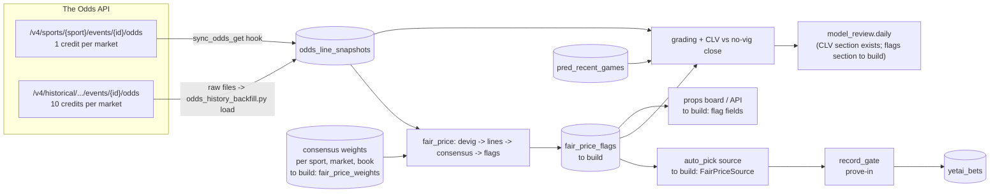

# Fair-price engine: design, cost and build plan (2026-11-14)

Companion to docs/edge-strategy-2026-11-14.md (the why). This document is the what and how: what
each piece is called, where it lives, what it costs in Odds API credits, how it is tested, and the
result on last season's data that decides whether the live engine gets built. Every table, module,
task and env switch below either exists on branch `edge/engine-plan` (built on PR #184) with its
file path, or is marked **to build**.

## In plain language

- Sportsbooks disagree with each other on player props. If we remove each book's margin and
  average the books (weighting the ones that are usually right more), we get a fair price for
  each prop. When one book's price is better than that fair price by enough, that is a bet worth
  flagging: no model of ours is involved.
- Whether that works is checked against the closing line, because a price that beats the
  closing consensus wins money in the long run, and that shows up in hundreds of bets rather than
  the thousands a win/loss record needs.
- Before building any of it live, we replay last season: every NBA rebounds and assists prop, at
  three moments before each game (10 hours, 6 hours, and 5 minutes before tip), from ten books,
  bought from the Odds API's historical archive with the one-month 100K plan. The rules for what
  counts as "go", "no go" or "inconclusive" are written below, before the result was computed.
- Then, in order: live flags in shadow, a news-speed engine (books are slow to re-price props after
  injury news), and only last, our own projection as a small extra weight on top of the market.

## A. System picture

One NBA prop, end to end (Jokic rebounds 12.5 on a 19:30 ET game):

1. Odds fetch. Today: the NBA pipeline (`run_nba_update_pipeline` 03:30 ET,
   `run_nba_pregame_refresh` 12:00 and 17:00 ET, `app/tasks/etl_pipeline.py`) calls
   `_fanduel_lines._get_event_market_odds` with `bookmakers=PROP_BOOKS` (10 books, 1 credit per
   market); `nba.close_capture` (`app/services/etl/nba/close_capture.py`, beat every 10 min
   11:00-23:50 ET) fetches rebounds and assists once ~25 min before tip. Phase 1 adds a poller
   (**to build**, `app/services/fair_price/poller.py`, task `fair_price.poll`).
2. Snapshot. `app/services/odds_api_sync.sync_odds_get` hands every 200 response to
   `odds_snapshots.record_response`, which parses it per book (`parse_event`) and appends or
   touches rows in `odds_line_snapshots` (`record_rows`): identity (event_id, market, player_key,
   book), unchanged values only move `last_seen_at`. Started games are not recorded.
3. Fair price. At each poll, for each prop: each fresh book quote is de-vigged
   (`fair_price/devig.py`, power method), converted to a common line where books differ
   (`fair_price/lines.py`, negative binomial), and pooled with the fitted book weights
   (`fair_price/consensus.py`). Leave-one-out: a book is never part of its own fair price.
4. Flag. `fair_price/flags.evaluate_prop` flags book X's over 12.5 at +105 when the other books'
   pooled fair probability is 0.53: EV = 0.53 x 2.05 - 1 = 8.7% >= 5%, at least 3 other books,
   quotes under 30 minutes old. The flag carries book, line, price, fair probability, EV,
   playable-to price (the worst price still worth 2% EV at p = 0.53: -108,
   `flags.playable_to`), n_books and expires_at (30 min, or tip if sooner).
5. Publish (Phase 1, after the backtest and the shadow period): written to `fair_price_flags`
   (**to build**); an auto-pick source turns live flags into candidates; the record gate decides.
6. Grade. After the game: result at the flagged price from `pred_recent_games`
   (`odds_math.units_won`), and CLV = closing no-vig consensus probability of the flagged side at
   the flagged line minus the implied probability of the flagged price
   (`fair_price/backtest.py` computes it the same way offline).

## B. Data layer

### What is captured, when, from which books
| Source | Endpoint | Books | Markets | When | Credits |
|---|---|---|---|---|---|
| NBA props | live event odds | PROP_BOOKS: fanduel, draftkings, betmgm, williamhill_us, fanatics, espnbet, betrivers, hardrockbet, pinnacle, ballybet (`etl/nba/_fanduel_lines.py`) | points, rebounds, assists, threes, PRA, steals, blocks | 03:30, 12:00, 17:00 ET | 7 per event per run (verified: x-requests-last 7) |
| NBA game lines | live odds | same 10 | spreads, totals, h2h | same runs | 3 per run |
| NBA close | live event odds | same 10 | NBA_CLOSE_CAPTURE_MARKETS (rebounds, assists) | once per event, ~25 min before tip | 2 per event |
| NHL, NFL, WNBA | their fetchers via sync_odds_get | their own books | saves, shots, totals; QB/receiving/anytime TD; WNBA props | their schedules | captured at no extra cost |
| Historical NBA props | historical event odds | the backfill list (below) | rebounds, assists | T-600, T-360, T-5 min | 20 per event-snapshot (verified) |

Daily NBA cost today, ~7.6 games/day: about 184 credits (edge-odds-capture handoff); all sports
together 200 to 350 a day (coordinator's reading of production usage) [unverified per sport].

Backfill book list: fanduel, draftkings, betmgm, williamhill_us, espnbet, betrivers, hardrockbet,
pinnacle, novig, prophetx (`DEFAULT_BOOKS` in `scripts/odds_history_backfill.py`). Fanatics and
ballybet were dropped for the backfill: on the probed games they quoted 1 and ~6 players; novig
and prophetx (prediction-market exchanges that do not limit winners) take their places at the
same cost. **To build** in Phase 1: the same swap in live `PROP_BOOKS` so the live engine reads
what the backtest measured (one line; costs nothing).

### "At projection", "at flag", "closing"
Definitions live in `app/services/odds_snapshots.py` and are used unchanged:
- opening: the earliest observation we hold;
- at projection: each book's observation with the greatest first_seen_at <= the projection row's
  `projected_at` (`quotes_at`);
- closing: each book's observation with the greatest first_seen_at < commence_time
  (`closing_index`, `closing_quotes`);
- at flag (new, `fair_price/backtest.py`): a quote is present at time t iff
  first_seen_at <= t <= last_seen_at; its age is t - last_seen_at. Live flags use only quotes
  with age <= 30 min (`FlagRule.max_age_min`).
For the backfill, first_seen_at/last_seen_at are the API's snapshot timestamps, so "present at a
snapshot" means "in that snapshot".

### Growth, retention
A full NBA prop fetch is ~250 to 600 rows per event per run (10 books, 7 markets, alternate lines
from espnbet). Dedupe keeps unchanged quotes as one row, so growth is driven by line moves:
measured on today's slate, 2,294 rows for 5 events in one pass; at 3 passes + close and ~30%
moved per pass, roughly 600 x 7.6 x 2 = ~9,000 rows/day for NBA (~3.3M rows/year, ~1 GB with
indexes). The Phase 1 poller at 30-minute cadence adds about 4 times that. Rule: no partitioning
below 20M rows; above it, monthly range partitions on game_date (**to build** if reached);
prune nothing (the history is the asset). The backfill adds about 2M rows (measured after load;
see the backtest report).

### Historical backfill format, one schema
`scripts/odds_history_backfill.py fetch` saves every response as a raw JSON file
(`{kind, path, params (no key), status, headers, fetched_at, body}`) under
`.factory/edge-engine-plan/artifacts/odds_history/nba_2025-26/` (`events/<date>.json`,
`odds/<date>/<event>__T-600.json`, `calls.csv` with the credit headers of every call).
`load` replays the files through `odds_snapshots.parse_historical` (the historical wrapper's
`data` goes through the same `parse_event` as live payloads) and `record_rows(db, rows,
now=<snapshot timestamp>)`, in chronological order per event, idempotently. So the backtest and
the live engine read one table with one meaning. The files are the purchased asset: they can be
replayed into production later without buying again.

## C. Fair-price engine (`backend/app/services/fair_price/`, built)

### De-vig (`devig.py`)
For one book's two-way market with implied probabilities pi_o, pi_u (pi = 1/decimal price) and
overround S = pi_o + pi_u:
- multiplicative: p_i = pi_i / S (what `odds_math.devig` already uses);
- additive: p_i = pi_i - (S - 1)/n;
- power: p_i = pi_i^k with k solving sum pi_i^k = 1;
- Shin: p_i = (sqrt(z^2 + 4(1-z) pi_i^2 / S) - z) / (2(1-z)), z solving sum p_i = 1. For two
  outcomes Shin equals additive exactly (tested), so it only differs for 3+ outcome markets.
Worked example, -150/+130: multiplicative 0.5798, additive/Shin 0.5826, power 0.5840 (tests in
`tests/test_fair_price_devig.py`). On lopsided prices (-500/+350) the methods diverge: 0.789 /
0.806 / 0.815 for the favourite: power and Shin move margin onto the long shot, which is where
the favourite-longshot bias puts it.
When used: power is the default for every two-way prop (`DEFAULT_METHOD`). Near even money all
four agree within 0.3 points, so the choice only matters on lopsided and alternate lines. Which
method is right is an empirical question: the backtest reports log loss and Brier score of the
closing consensus under each method per market, and the live default is switched only if another
method wins out of sample on >= 2,000 graded props. One-sided quotes (anytime TD Yes-only,
alternates with one side): `devig.one_sided(price, k)` with k the same book's power exponent on
its two-way quotes of that market in the same snapshot; they can be flagged, never used as
consensus inputs (v1).

### Line conversion (`lines.py`)
Books often quote different lines for one player (6.5 vs 7.5). Prices are never mixed across
lines; instead each book's fair P(over L_b) is converted to the target line. Model: the stat is
negative binomial with mean mu and variance phi x mu (Poisson when phi <= 1). Solve mu from the
book's p at L_b (bisection), then read P(over L*) at the target. Integer lines condition on no
push. phi per market (pooled within-player var/mean on 2025-26 box scores, players with >= 20
games of >= 15 minutes): rebounds 1.262, assists 1.188, points 2.799, threes 1.134, steals 1.047,
blocks 1.078, PRA 2.728. These are unconditional (they include role changes) and overstate the
spread given the line: refit on the backfill as the phi that maximises the likelihood of outcomes
given the closing consensus mean (**to build**, after the backtest). Refusal: no conversion beyond
MAX_SHIFT (rebounds/assists 2.0, threes/steals/blocks 1.0, points 4.0, PRA 5.0), when p is outside
[0.02, 0.98], or for an unknown market. Points and PRA use the same family with large phi; a
normal approximation would be no simpler and is worse in the tails.

### Blending books (`consensus.py`)
Logarithmic pool: logit p* = sum_b w_b logit p_b / sum_b w_b over the books present.
- Weights per (sport, market, book), fitted by minimising the log loss of the pooled closing
  consensus against outcomes, w_b = exp(theta_b), L2 penalty toward equal weights
  (`fit_weights`, scipy L-BFGS-B).
- Data: closing observations with box-score outcomes (each prop: every book's de-vigged p
  converted to the modal closing line; pushes dropped). Fitted on outcomes, not on the close, so
  the CLV measurement is not circular.
- Schedule: monthly, expanding window, walk-forward (weights for month m use months < m only).
  Live: a monthly task (**to build**, `fair_price.fit_weights`, 1st of month 06:00 ET) writes
  `fair_price_weights` (**to build**: sport, market, book, weight, n, fitted_through, version).
- Minimum sample: a book needs >= 300 props in the window to get its own weight; otherwise
  weight 1.0 (the geometric-mean weight of the fitted books). Fewer than 2 fitted books: equal
  weights.
- Missing book: the pool renormalises over the books present; a flag needs >= 3 books other than
  the flagged one.
- Pinnacle and other reference-only books (`odds_math.REFERENCE_ONLY_BOOKS`) count in the
  consensus and are never flagged.

### Expected value, flag rule, playable-to, expiry (`flags.py`)
- EV per unit = p x decimal(price) - 1, where p is the leave-one-out pooled fair probability of
  the side at the quote's own line.
- Flag when: EV >= 5% (`FlagRule.min_ev`, the Kaunitz / Data Golf starting point; lower only on
  evidence), >= 3 other books in the consensus, every quote used <= 30 min old, fair p of the side
  in [0.15, 0.85] (keeps extreme alternate lines out until line conversion is validated there),
  book not in FAIR_PRICE_EXCLUDED_BOOKS and not reference-only.
- Prediction markets (novig, prophetx; kalshi is in the feed's us_ex region but did not return
  NBA props on the probed game): treated as books. Their prices are exchange quotes with low
  margin, so they enter the consensus and can be flagged; results are always reported by book so
  they can be excluded by env if their quotes prove stale or unfillable.
- Playable-to: the worst American price at which EV at the same fair p is still >= 2%
  (`playable_to`); same line only: a different line is a different bet and is re-evaluated.
- Expiry: 30 minutes after the observation the flag was based on, or tip-off if sooner; a live
  flag is re-evaluated at every poll and withdrawn when it no longer clears 2% EV.

## D. News engine (Phase 2; design only, nothing built)

### Sources and timing
| Event | Source | Timing | Have it? |
|---|---|---|---|
| NBA injury report | official PDFs `ak-static.cms.nba.com/referee/injury/Injury-Report_YYYY-MM-DD_HH_MMAM.pdf` ([official.nba.com](https://official.nba.com/nba-injury-report)) | Day-before status by 5 p.m. local; game-day report 11 a.m.-1 p.m. local (8-10 a.m. for tips at 5 p.m. or earlier); updated continually, links show a 15-minute grid | Not ingested. We scrape CBS Sports (`etl/nba/update_injury_status.py` -> `pred_player_injury_status`), which lags the league file. **To build**: PDF poller + parser |
| NBA starting lineups | team/league releases, about 30 min before tip [unverified rule] | 30 min pre-tip | No free structured source in the code; ESPN game summary is the candidate (`etl/nba/_espn.py` already used for schedules) |
| NHL goalies | team announcements, morning skate reports | morning to ~1 h pre-game [unverified] | Projection-side only (`run_nhl_pregame_refresh` 16:45 ET) |
| NFL inactives | league, 90 min before kickoff [unverified here; from the strategy research] | T-90 | `run_nfl_gameday_availability` beats exist (Sun/Mon/Thu/Sat) |
A paid structured news feed (e.g. a lineup/injury API) is not needed for the event study; it is
needed only if the PDFs prove too slow (decided by the event study).

### Event study: how slow are books?
For every status change (player, old status, new status, source timestamp): record
`news_events` (**to build**: id, sport, player_key, team, event_id, status_from, status_to,
source, published_at, detected_at). Then, from `odds_line_snapshots`, per book and affected
market (the player's own props and his teammates'), the first observation after published_at
whose line or price changed, or the market's disappearance (last_seen_at stops advancing):
`news_reprice` (**to build**: news_event_id, book, market, player_key, first_change_at, lag_min,
line_before, line_after, suspended). The measurement needs a snapshot cadence finer than the
window: polling the affected event's props at +0, +5, +10, +20, +40 minutes after each status
change (7 markets x 5 polls = 35 credits per change) measures windows down to ~5 minutes; the
3-runs-a-day schedule cannot. Cost: NBA status changes on game days are roughly 20 to 60
[unverified estimate] -> 700 to 2,100 credits/day, 21k to 63k a month: inside the 100K plan only
without a broad Phase 1 poller, comfortably inside the 5M plan. Note: the historical endpoint costs
10x the live one per snapshot, so the event study must run live, not from history.

### Playing time and redistribution (first simple version)
- Inputs: `pred_player_expected_minutes` (exists, `etl/nba/update_expected_minutes.py`), last 10
  games' minutes and starts from `pred_recent_games`, injury status, the game spread (blowout risk).
- Outputs per player-game: P(plays), E[minutes | plays], starter flag.
- Redistribution when player A is out: A's expected minutes go to teammates in proportion to
  their minutes in games A missed this season (with-without), falling back to position-group
  share; each teammate's stat = his per-minute rate (last 20 games, shrunk to season) x new
  minutes, then A's team-level share of the stat (rebound share, assist share, shot share) is
  reallocated by the same weights. Output: re-priced mean for every teammate prop, converted to
  a fair probability at the book's line with `lines.p_over`. This is what gets compared with the
  stale book line during the window.

## E. Model blend (Phase 3)
logit p_final = logit p_fair + beta x (logit p_model - logit p_fair), with p_model from the
projection converted by `lines.p_over` at the same line. beta is fitted walk-forward (monthly,
expanding) by logistic regression of outcomes with offset logit p_fair; reuse the residual
harness's walk-forward split and reporting (`app/services/etl/nba/residual/evaluate.py`) and its
gate logic (`residual/gate.py` `beats_line_gate`: n >= 150, error <= line, slope t >= 1.645).
Gate for the blend: beta stays 0 until a full walk-forward season gives beta > 0 with t >= 1.645
on >= 300 graded props per market; a fitted beta above 0.5 is capped at 0.5 (the strategy's
"minority weight"). Today both residual models fail their gate (handoff edge-nba-residual), so
beta = 0 and the engine is market-only.

## F. Publishing and product
- A flag contains: sport, event, game time, player, market, side, line, book, price, fair
  probability, EV, playable-to price, books in the consensus, observed_at, expires_at, and the
  rule version. Table `fair_price_flags` (**to build**; one row per (event, market, player_key,
  book, side, line, observed_at); later columns closing_prob, clv, result, units).
- Surfaces: (1) auto-pick: a new source `app/services/auto_pick/sources/fair_price_source.py`
  (**to build**) yields `BetCandidate(market_type=PLAYER_PROP, market_line=line,
  market_odds=price, projection_metadata={stat, book, fair_prob, ev, playable_to, expires_at,
  n_books, source: "fair_price"})`. The record key gets its own stat label (e.g.
  `NBA/player_prop/rebounds_fair`) listed in AUTO_PICK_PROVE_IN_KEYS, so it publishes only after
  a proven record (`record_gate.drop_reason`). The candidate's `hard_gate_reason` gains an
  expiry check (now < expires_at) (**to build**). (2) Props board: flag fields on the NBA prop
  rows (**to build**, API only first). (3) Daily model review: a "Fair-price flags" section next
  to the existing CLV section (`model_review_service._clv_section`) (**to build**).
- Stake: `residual/publish_rule.decide` (exists, off) with p = fair probability, p_se = the
  standard error of the pooled logit across books (spread of the books' converted probabilities /
  sqrt(n_books)), calibration_error = the backtest's mean |p - observed| for the market; capped
  quarter Kelly, max 2% of bankroll, shown in units.
- What users are told: the book and price the edge is at, the playable-to price, the expiry
  time, that retail books limit winning accounts, and that a positive-EV bet still loses often.
- Honesty metrics (review and public record): CLV against the no-vig consensus close in
  probability points, ROI at the flagged price with a 95% interval (clustered by date), hit rate
  with a Wilson interval, by market and by book, including losing ones.

## G. Operations
- Beat changes (**to build**, all in `app/celery_app.py`): `fair_price.poll` every 10 min
  10:00-23:50 ET (polls only events with tip in the next 10 h whose last poll is older than the
  phase's cadence, so idle runs cost 0); `fair_price.grade` daily 05:30 ET (after
  `nba_store_actuals`); `fair_price.fit_weights` monthly. Existing entries unchanged.
- Worker load: the Railway worker runs one process with embedded beat at concurrency 2
  (`scripts/railway-celery.sh`; the brief's "concurrency 1" is out of date). Long jobs (MLB
  profile rebuild, retrains) can hold both slots for an hour. The poller must not wait behind
  them: route `fair_price.*` and `app.tasks.etl_pipeline.nba.close_capture` to a queue `odds`
  served by a second worker process (`celery -A app.celery_app worker -Q odds --concurrency=1`,
  same image, **to build**), with `expires` = cadence so a missed run is dropped, not piled up.
- Failure modes:
  - Feed down / HTTP errors: `sync_odds_get` returns None, nothing is recorded, quotes age past
    30 minutes, no new flags; open flags expire on their own. Alert after 3 consecutive empty
    polls on a game day.
  - Quota exhausted / daily budget hit: `odds_api_budget.guard_sync` blocks the call
    (ODDS_API_DAILY_BUDGET, prod 500, code default 250); same outcome as feed down. The poller
    must have its own budget share (**to build**: FAIR_PRICE_DAILY_CREDITS, default 400) so it
    cannot starve the projection pipelines.
  - One book missing: renormalised pool; fewer than 3 other books -> no flag.
  - Stale snapshot: max quote age 30 min; flag expiry 30 min.
  - Bad price (0, |price| < 100): ignored by de-vig (`two_way` returns None).
- Kill switches: ODDS_SNAPSHOTS_ENABLED (exists), NBA_CLOSE_CAPTURE_ENABLED (exists),
  AUTO_YETAI_PICKS_ENABLED (exists), FAIR_PRICE_ENABLED (poller+flags, **to build**, default 0),
  FAIR_PRICE_PUBLISH_ENABLED (auto-pick source, **to build**, default 0),
  FAIR_PRICE_EXCLUDED_BOOKS (exists in `flags.default_rule`).
- Alerting through what exists: AdminNotification rows written by `app/core/celery_signals.py`
  for tasks in `PIPELINE_ENQUEUE_CATALOG` (`app/data/celery_tasks.py`; the new tasks must be added
  there), and the daily model review email (`model_review.daily`, 09:45 ET).

## H. Cost model
Live event odds cost 1 credit per market per region per call; historical cost 10 per market per
region (verified against the docs and the probe headers). E = 7.6 NBA games a day on average.
| Phase | What | Credits/day | Credits/month | Plan |
|---|---|---|---|---|
| 0 (now) | NBA 3 runs x 7 markets + game lines + close; other sports | ~184 NBA; 200-350 all [prod reading] | 6k-10.5k | 20K ($30) |
| 1 shadow | + poller, reb+ast, every 30 min from T-10h: 20 polls x 2 x E | +304 | +9.1k (total ~16-20k) | 20K tight; 100K ($59) safe |
| 1 full | poller, 7 prop markets, every 30 min | +1,064 | +32k (total ~38-42k) | 100K |
| 1 fast | poller, reb+ast, every 10 min | +912 | +27k | 100K |
| 2 study | 35 credits per NBA status change, 20-60 changes/day [unverified] | +700 to 2,100 | +21k to 63k | 100K (only without "1 full"); 5M ($119) |
| Backfill (one-off) | 2025-26 Nov 1-Apr 12, reb+ast, 3 snapshots, 10 books | - | 68,494 upper bound (actual: calls.csv) | 100K, one month |
Plan prices (verified, the-odds-api.com 2026-11-14): 20K $30, 100K $59, 5M $119, 15M $249.
Optional feeds from the strategy: a consensus sharp-line feed (e.g. Unabated) about $799/month
[unverified, third-party figure]; faster odds feeds: quotes only [unknown]; NBA lineups/injury
APIs: not priced [unknown]. None is needed before the backtest verdict.

Backfill menu (from `odds_history_backfill.py estimate`, games = box-score games in the DB):
| Option | Games | Markets | Snapshots | Credits | Answers | Cannot answer |
|---|---|---|---|---|---|---|
| Minimum | 1,309 (whole season) | reb, ast | T-360, T-5 | 52,571 | CLV/ROI of projection-time flags vs close | whether early lines are softer; edge by hours before tip |
| Recommended | 1,309 | reb, ast | T-600, T-360, T-5 | 78,751 | + early-vs-late flags, edge decay | other markets |
| Full | 1,309 | + points | 3 | 118,021 | + the most liquid market | does not fit the month |
| Chosen (run) | 1,139 (Nov 1-Apr 12) | reb, ast | T-600, T-360, T-5 | 68,494 | as recommended, regular season | October (80 games) and play-in/playoffs (90) were cut to stay under ~70k with a 25,000 reserve |
Marginal cost on the chosen range: each extra market 34,170; each extra snapshot 22,780; a second
region (11-20 books) doubles the odds credits. Reserve for daily pipelines: 25,000 credits
(the fetch stops before the quota would drop below it; `--floor`).

## I. Build sequence
| # | Phase | Scope | Depends on | Acceptance (numbers) | Stop rule | Size |
|---|---|---|---|---|---|---|
| 0 | Measurement | snapshots, best price, grading at price, CLV (PR #184) | - | every graded call has a close and CLV within 2 weeks of deploy | - | **built** (PR #184; prod has the migration, table empty at 2026-11-14 18:30 ET) |
| 0.5 | Library + backtest + backfill | `fair_price/`, `odds_history_backfill.py`, `fair_price_backtest.py` | 0 | tests; estimate = tiny run cost per call; backtest reproducible from raw files | - | **built** (this branch) |
| 0.6 | Season backtest | run on 2025-26 | 0.5 + credits | verdict per the criteria below | NO GO stops Phase 1 | done in this session (see report) |
| 1a | Live shadow flags | PROP_BOOKS swap, poller (reb+ast, 30 min), `fair_price_flags`, weights table, grade task, review section, `odds` queue | 0.6 = GO or INCONCLUSIVE(a) | 300 shadow flags: mean CLV > 0 with lower bound > 0; ROI >= 0 | 300 flags without positive CLV: fix weights/feed speed first | ~4-6 builder days |
| 1b | Publish | auto-pick source, prove-in key, expiry gate, stake via publish_rule, board fields, user copy | 1a passes | record gate admits the key on its own record | gate withholds -> stays shadow | ~3 days |
| 2a | News event study | PDF poller + parser, `news_events`, `news_reprice`, burst polling | 1a poller | 200 status changes measured; median lag per book | median lag < 5 min at every book: stop (needs a faster feed) | ~4 days |
| 2b | Playing time + redistribution | P(play), minutes, with-without redistribution | 2a shows a window | redistributed means beat the stale line's CLV in > 55% of 200 events | no positive CLV after 200 events | ~5-8 days |
| 3 | Model blend | p_final with walk-forward beta | 1a, rebuilt projection | beta > 0, t >= 1.645, n >= 300 per market | beta ~ 0 after a season: display-only | weeks (model rebuild) |
Sizes are honest guesses for one builder with verification, not commitments.

## Backtest decision criteria (fixed 2026-11-14, before any season result was computed)
Primary analysis, decided now and not tuned afterwards:
- Data: 2025-26 regular season Nov 1 - Apr 12, player_rebounds + player_assists pooled, the ten
  backfill books, snapshots T-600 / T-360 / T-5.
- Rule: `FlagRule()` defaults (EV >= 5%, >= 3 other books, power de-vig, p in [0.15, 0.85],
  leave-one-out, pinnacle reference-only), weights fitted walk-forward by month (first month equal
  weights).
- Primary flags: flags at non-closing snapshots (T-600, T-360), first per (event, market, player,
  book, side). Closing-snapshot flags are scored on ROI only (their CLV is positive by
  construction).
- CLV = closing no-vig consensus probability of the side at the flag's line minus the implied
  probability of the flagged price. Intervals: 95%, clustered by game date; hit rate Wilson.
Verdict (code: `fair_price/backtest.py` `verdict`):
- INVALID (fix the pipeline, no conclusion): the sign-flip placebo's mean ROI differs from its
  known coin-flip expectation by more than 1.96 standard errors, or the random-book-random-side
  baseline has a mean CLV whose lower bound is above 0.
- GO: n >= 300 primary flags, mean CLV lower bound > 0, ROI point estimate >= 0, and the paired
  difference (flag CLV minus its random-baseline CLV) has a lower bound > 0. Action: build 1a.
- NO GO: n >= 300 and mean CLV upper bound <= 0, or n >= 1,000 and ROI upper bound < 0. Action:
  do not build the live engine on this consensus; diagnose (weights, books, de-vig) once, then stop.
- INCONCLUSIVE: anything else. (a) CLV > 0 with lower bound > 0 but ROI interval spanning 0 or
  negative point estimate: build 1a in shadow only, no publishing, and let 300 live flags decide.
  (b) n < 300: report; lowering the threshold is not allowed to rescue the verdict.
Secondary analyses (by market, book, edge bucket, hours before tip, thresholds 3/7.5/10%,
de-vig method) are reported and may shape Phase 1 settings, but they never change the verdict.
Smallest informative sample: with a per-flag CLV standard deviation of about 4-6 probability
points and date clustering roughly doubling the variance, 300 flags detect a mean CLV of about
+1 point; ROI needs about 7,000 flags to detect +3%, which one season of two markets will not
give, which is why ROI only has to be non-negative and CLV carries the decision.

## J. Risks and open questions
- Licensing: NBA Stats tracking data (rebound chances, potential assists) and MLB Statcast are
  terms-restricted for commercial use [unverified, check before Phase 3]; MoneyPuck data is
  non-commercial without an agreement. The Odds API data itself: redistribution of raw odds is a
  question for their terms before showing historical prices publicly [unverified].
- Our own snapshot cadence is the speed limit: flags are only as fresh as the last poll, and the
  strategy's evidence says about 30% of displayed edges are gone when checked.
- Winners get limited; the product's value per user decays with success. Exchanges (novig,
  prophetx) are the outlet; their liquidity at the flagged price is unknown.
- Line conversion: the NB phi values are unconditional; mis-set dispersion produces false edges
  on off-line quotes. The backtest reports flags by book so a conversion artefact shows up as one
  book (often espnbet's alternates) dominating.
- The backtest uses three snapshots per game; live flags will see more prices, so live flag
  counts will be higher and possibly lower quality.
- Box-score coverage: games without box scores in `pred_recent_games` were not bought; players
  whose names do not map to a player_id are void (counted in the report).
- What the research could not establish (from the strategy): no peer-reviewed study of prop
  efficiency or news-reaction speed; whether opening lines are softer (the T-600 vs T-360 split
  is our first measurement); which vendor prices each book; whether Pinnacle prop prices are
  complete (it quotes only some players).
